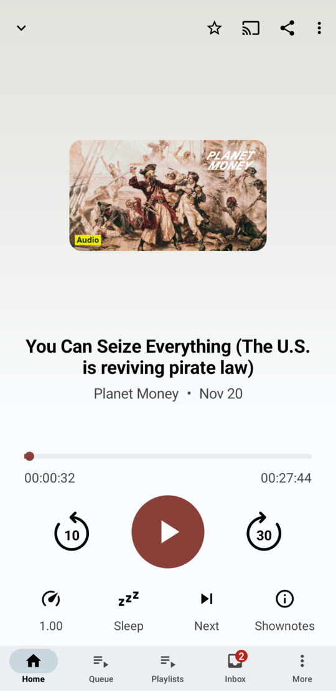
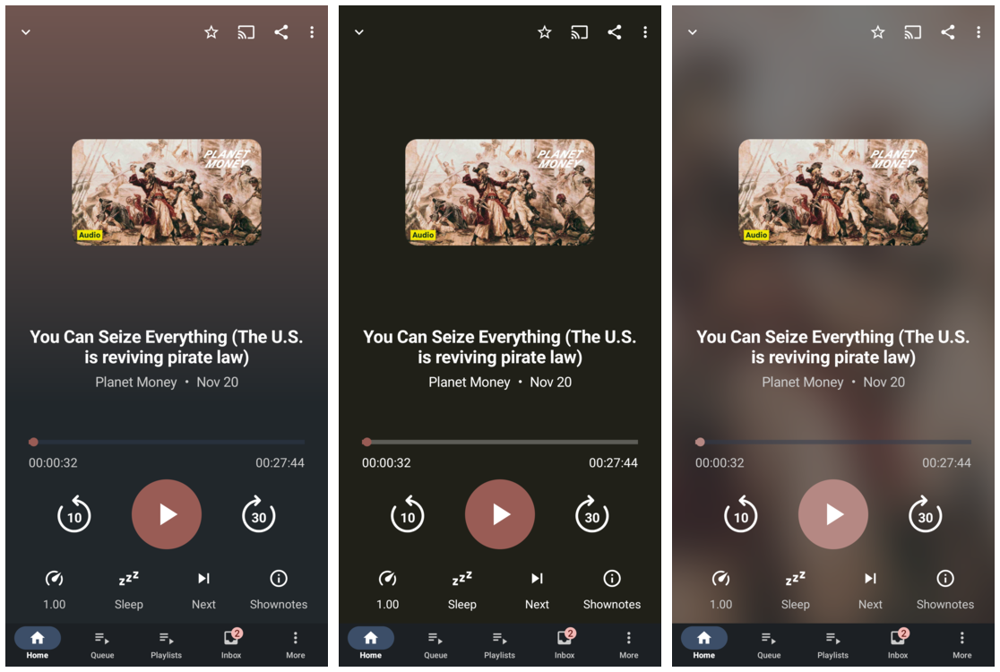

# The player and skip forward

## Skip forward time per podcast

Many podcasts play ads of about the same length. In a podcast's settings, set a **Skip forward time** (for example 60 seconds). Fast-forward then jumps ahead by that amount for this podcast's episodes, everywhere: the player, the notification and lock screen, headphone buttons, Android Auto and the watch. The number on the player's fast-forward button shows the time in use.

Leave it empty, or tap **Use global**, to go back to the global time (Settings → Playback → Fast-forward). Long-press the fast-forward button in the player to change the time: the podcast's own time if it has one, otherwise the global one.

## The modern player

The full-screen player has a new look: the artwork, the episode title and podcast name centred below it, and large, well-spaced controls (rewind, play, fast-forward), with speed, sleep timer, next episode and show notes in a labeled row below. Tap the podcast name to open the podcast. While a sleep timer runs, the Sleep button turns to the accent color and shows the time left; tap it to change or stop the timer.

### Background and colours

Settings → Castlist features → **Player background** picks how the player takes its colours from the episode's artwork:

- **Gradient from cover** (default): a colour from the artwork at the top, fading into the normal background behind the controls.
- **Solid cover colour**: the whole player in a colour from the artwork. The text turns white or dark to stay readable.
- **Blurred artwork**: the artwork itself, blurred and faded behind everything. Needs Android 12 or later; older phones get the gradient.
- **Theme colour**: the plain app background.

**Tint controls with cover colour** (on by default) gives the play button and progress bar a colour from the artwork. When that colour would be hard to see, the player lightens or darkens it, or falls back to the app's accent colour.

Prefer the original player? Switch back any time in Settings → Castlist features → **Player style → Classic**. The background settings only apply to the modern player.

On big screens and foldables the player rearranges itself; see [Foldables and big screens](foldables.md).
